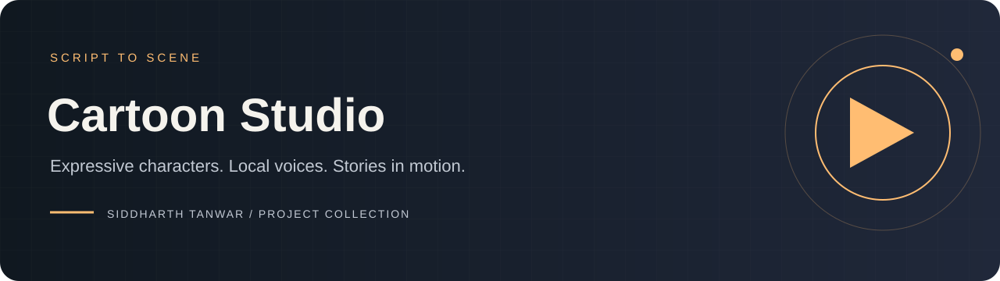
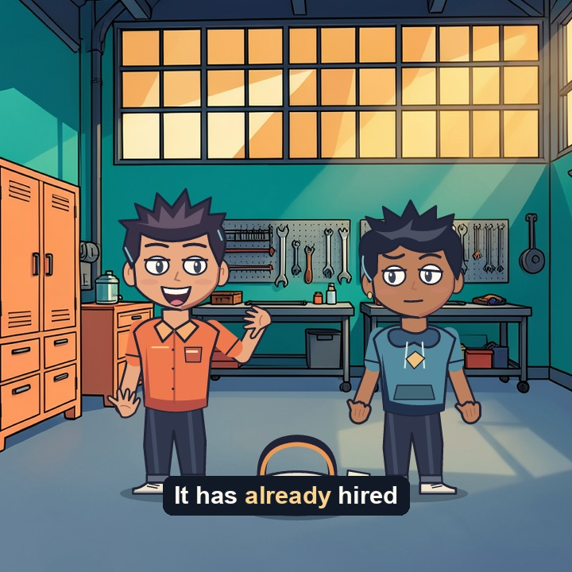
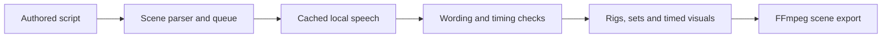

# Cartoon Studio

**Turn authored dialogue into expressive, locally rendered cartoon scenes.**

A Python and browser-based production studio for reusable character rigs, speech-driven mouth animation, directed acting, captions, and explanatory visuals. Built around a sequential local pipeline on Apple Silicon, with scene-by-scene H.264/AAC export.

[Get started](docs/SETUP.md) · [Script format](SCRIPT-FORMAT.md) · [Explainer scenes](EXPLAINER-SCENES.md) · [Architecture](docs/ARCHITECTURE.md) · [Full guide](README-ORIGINAL.md) · [File catalog](docs/FILE-CATALOG.md)



## At a glance

| Area | Included |
|---|---|
| Direction | Expressions, gestures, pose controls, framing, reaction shots, pauses |
| Characters | Original SVG rigs, avatar catalog, ensemble and historical character artwork |
| Speech | Local VoxCPM2 generation, voice caching, Whisper wording checks |
| Visuals | Imported/generated sets, props, timed diagrams and explainer scenes |
| Workflow | Markdown script import, reusable JSON episodes, persistent scene queue |
| Delivery | Separate MP4 scenes, subtitles, audio, stills, episode data and quality reports |

## Start creating

This is a source distribution of a working local installation, **not a one-click bundle of model weights**. Read [setup](docs/SETUP.md) before launching on a new machine.

1. Install the renderer dependencies with `Setup.command`.
2. Prepare the local model/runtime installation described in the setup guide.
3. Open `Start Cartoon Studio.command`, then visit `http://127.0.0.1:8768`.
4. Import [robot-vacuum.json](examples/robot-vacuum.json) or [coffee-machine.json](examples/coffee-machine.json).
5. Preview the acting and render an episode, or import a full script and render queued scenes separately.

[Original demo reports](renders/demo/) · [Coffee-machine reports](renders/coffee-demo/)

The historical demo video/audio files are no longer present in the source installation. The repository preserves the available scripts, captions, timelines and reports; generate a new export using the local models.

## From script to screen



## Explore the production library

| Resource | Purpose |
|---|---|
| [Script format](SCRIPT-FORMAT.md) | Import grammar and supported acting controls |
| [Explainer scenes](EXPLAINER-SCENES.md) | Diagrams, visual fields and synchronized reveals |
| [Explainer kit](explainer-kit/README.md) | Reusable explanatory scene examples |
| `otzi-kit/` | Historical story script, research and character materials |
| `car-history-kit/` | Automotive story materials and scene specifications |
| `human-manual-kit/`, `psychology-kit/`, `easier-life-kit/` | Additional authored script collections |
| `assets/avatars/` | Character catalog, SVG artwork and acting sheets |
| [Verification](VERIFICATION.md) | Original measured exports and checks |
| [Publication scope](docs/PUBLICATION.md) | Exactly what is included and kept local |

## Quality and limits

The strongest workflow is one or two characters in directed dialogue. Lip sync is approximate, not phoneme-perfect. English speech verification is the documented path. New body designs, elaborate physical interactions and new props require additional artwork or rig code. Scenes export independently; the studio does not automatically join the queue into a film.

Generated illustrations are not research evidence. Preserve sources and units in research-driven scenes; use conceptual diagrams when no quantitative evidence is available. Review every export for pronunciation, pacing, timing and visual clarity.

## Development

```sh
.venv/bin/python -m unittest discover -s studio -p 'test_*.py' -v
.venv/bin/python studio/render.py examples/robot-vacuum.json --out renders/my-episode
```

Tests and rendering have different dependency needs; see [validation notes](docs/VALIDATION.md). Historical reports are preserved without presenting them as fresh results.

## Attribution and distribution

Original studio scripts and rig artwork are included with upstream model references in the [full guide](README-ORIGINAL.md). No new blanket open-source license has been assigned to Cartoon Studio; public availability alone does not grant unrestricted reuse. Downloaded models retain their own terms. See [publication scope](docs/PUBLICATION.md).
